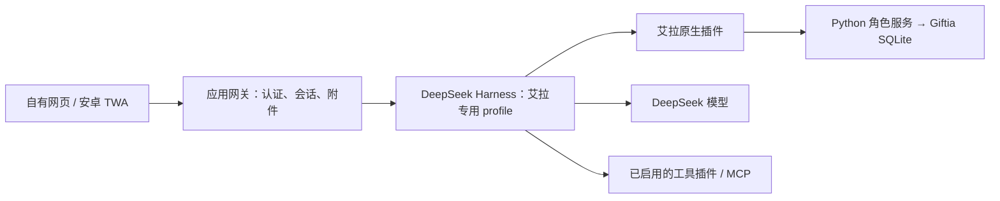

# 艾拉原生接入 DeepSeek Harness 实施计划

日期：2026-11-13。本文是 [Giftia 路线图](ROADMAP.md) 的专项实施方案。实际任务状态和发布记录沿用仓库现有约定。

阶段 1 已通过 Windows 和腾讯云隔离环境验收。复现命令、测试证据和下一阶段提示词见 [2026-11-16 阶段 1 记录](records/2026-11-16-harness-stage1.md)。

阶段 2 已通过本地隔离环境验收。角色接口、实际模型请求和数据库证据见 [2026-11-16 阶段 2 记录](records/2026-11-16-harness-stage2.md)。

阶段 3 已通过本地隔离环境验收。独立只读工具 `giftia-sample-tool-bundle@0.1.0` 的装卸、权限、模型请求与工具事件证据，以及阶段 4 的开工提示词，见 [2026-11-16 阶段 3 记录](records/2026-11-16-harness-stage3.md)。

阶段 4 已通过本地隔离网关和手机视口验收。附件采用应用网关，PDF 问答、页码来源、身份隔离及恢复证据见 [2026-11-16 阶段 4 记录](records/2026-11-16-harness-stage4.md)。

阶段 5 已完成腾讯云隔离候选的模拟性能、实际浏览器、旧数据兼容性与恢复演练。真实 DeepSeek 的三项 PDF 引用验收已通过，R1 隔离试用已由用户确认通过。 [2026-11-16 云端与恢复记录](records/2026-11-16-harness-stage5.md) · [2026-11-17 真实模型、试用与 R2 检查](records/2026-11-17-harness-stage5-live.md)

R2 于 2026-11-18 切换现有腾讯云和 `giftia.icu` 的回环源站。备份恢复、附件撤销、旧请求回执迁移与回退均有隔离证据。现有 Android 16 真机和原签名 App 已通过隔离候选的登录、PDF 页码来源、断线和刷新恢复。正式发布进入日常使用观察。 [R2 发布记录](records/2026-11-17-harness-r2.md)

## 1. 目标与首版范围

让艾拉成为可安装的 DeepSeek Harness 原生插件，普通聊天也经过 Harness。用户继续从自己的网页或安卓 TWA 进入艾拉的聊天界面。以后需要新功能时，在独立的艾拉 profile 中安装兼容的 Harness 插件，接入 MCP 服务，或编写自己的插件。

首版交付一条完整链路：**自有网页里的普通聊天、一个可独立启停的只读工具、一份能引用页码并追问的文本 PDF**。先验证原生插件和数据边界，再做正式界面。Word、Excel、图片理解和更复杂的操作在这条链路稳定后逐项加入。附件类型、模型读取能力和界面预览分别验收。

人物沿用项目已选的 B 方向，机制对照固定同一份人物配置和等效模型参数，避免把换运行时、换人设和换模型的效果混在一起。实际发布的人设另按已完成的体验验收决定。已记录的现网基线为腾讯云 Ubuntu 24.04、约 2 GB 内存、Cloudflare Tunnel 转发到本机 8111。实施时重新核对。 [人物约定](CHARACTER.md) · [项目结构](PROJECT.md) · [腾讯云运行维护](OPERATIONS.md)

## 2. 运行结构与数据归属



| 组件 | 职责 |
|---|---|
| 艾拉原生插件 | 以 Cordis 插件和 bundle 安装。注册人物提示、按轮获取有效角色状态、暴露受限的记忆工具，在对话提交时写回角色服务。Harness 的 agent loop 负责模型调用和工具循环。 |
| Python 角色服务 | 首版复用既有寿命、关系、心情、记忆视角、退化、撤回和回收逻辑。提供窄接口，接收经网关确认的身份。将状态读取和写入交给现有单线程路径。 |
| Harness 会话与工具 | 管理运行中的会话、工具结果、事件、恢复和可选压缩。第三方功能通过 profile 配置装卸，插件不直接打开 Giftia 数据库。 |
| 自有网页与网关 | 延续现有域名和 TWA 入口的产品形态。网关持有身份到会话的映射，对外提供稳定的聊天、历史、取消、重连及附件接口。网页只接收显示需要的事件。 |

建议把 Python 侧接口限制为准备本轮上下文、执行授权的角色工具、提交本轮结果三类。准备和提交都带经服务端解析的身份、实例号及请求 ID。先检查现有 `Giftia.handle()` 与模型调用、写库的耦合，把可复用的编排切出来。直接调用整条旧聊天入口再把结果交给 Harness 会重复生成。重试、重启和重复事件必须复用请求结果，不能重复推进关系、写记忆或消费额度。

**Giftia SQLite 继续保存角色状态和可供艾拉召回的长期记忆。** Harness 的持久会话记录服务于会话恢复。绑定键至少包括搭档或访客身份、艾拉实例号和会话用途。角色上下文从 Giftia 当前授权视角产生。Harness 的历史、摘要、工具结果和附件内容也要经过同一可见性判断，避免另一份历史绕开角色规则。第一版可先关闭自动压缩，以受控历史验证实际模型输入。只有证明压缩和恢复后能排除已撤回、遗忘或前任内容，再为日常会话启用压缩。若旧摘要无法可靠剔除，废弃对应模型会话并用当前允许的内容重建。旧记录的展示和保留按产品策略处理。

插件包声明兼容的 Harness 版本，在锁定的版本上验证后升级。自有 UI 通过网关使用稳定的应用接口。若选官方 Host 会话和附件链路，先验证该版本的调用及事件契约。官方 Web 的附件能力与 Python SDK 的公开输入能力不同，通用文件不能假设直接经 SDK 传递。备选方式是网关管理上传，插件通过受限的解析服务读取指定文件的指定页。 [Harness 架构](https://deepseek-harness.github.io/deepseek-harness/en/reference/) · [插件打包](https://deepseek-harness.github.io/deepseek-harness/en/develop/basic/publish) · [会话与压缩](https://deepseek-harness.github.io/deepseek-harness/en/reference/subsystems/compaction) · [附件](https://github.com/deepseek-ai/deepseek-harness/blob/master/docs/subsystems/attachment.md) · [SDK 输入](https://github.com/deepseek-ai/deepseek-harness/blob/master/python/sdk/README.md) · [Host 网关](https://deepseek-harness.github.io/deepseek-harness/en/reference/api-gateway)

## 3. 分阶段实施

**集中验收。每个大阶段的实施工作完成后，再统一运行一次该阶段的关键测试。** 阶段内按实施顺序推进，把测试集中留到阶段末。验收按下表覆盖本阶段的通过条件和直接受影响的功能。发现问题后修复并复测受影响的用例，复用仍然有效的结果。验收记录写明覆盖范围、结果及下一阶段的前置条件。

| 阶段 | 工作 | 通过条件 |
|---|---|---|
| **1. 锁版本，搭隔离环境** | 检查本地工作区、当前 Giftia 提交和服务器资源。选择能覆盖目标能力的官方 Harness 发行版，固定版本与依赖，建独立用户、目录、Harness home、回环入口和合成数据库。准备模拟模型和最小 bundle。阶段末集中核对启动、重启、开发加载、打包和装卸。 | 记录实际版本、启动方式及复现命令。艾拉 bundle 装入独立 profile 后能加载。生产站点与测试入口分别可辨。 |
| **2. 接入角色机制** | 接通按轮准备、记忆工具和提交链。阶段末用合成数据验证普通聊天、关系推进、最近上下文、长期召回、工具写入、撤回、遗忘、访客隔离和换任。抓取测试模型收到的请求，验证上下文及模型参数。 | 回复由 Harness 生成。一次有效请求只提交一次。重启、失败重试、切换身份和换任后均符合原有角色语义。旧内容排除检查落到实际模型请求。 |
| **3. 证明插件可扩展** | 写一个返回固定资料的最小只读工具 bundle，或接入一个确认兼容的只读插件。阶段末集中验收安装、调用、停用和卸载，检查工具列表和结果事件。使用两个角色视角验证配置和访问范围。 | 增加工具无需修改艾拉核心或重做网页。工具可用性受服务端配置控制。停用后工具从模型调用范围消失，普通聊天继续可用。 |
| **4. 跑通附件与自有 UI** | 先确定上传走 Harness Host 还是应用网关。用一份有文本层、跨页放置测试内容的 PDF，完成上传、取消、失败重试、按页提取和引用。接入手机优先的聊天界面，完成普通消息、附件卡片、工具状态、历史及断线恢复。 | 网页可完成“上传 → 提问 → 页码引用 → 追问 → 刷新或重启后继续”。失败和取消状态准确。不同身份无法读到彼此的历史或附件。文档内容进入回答时带来源，不自动写成共同经历。 |
| **5. 云端试用与切换准备** | 在腾讯云隔离实例上测空闲及读 PDF 时的内存、磁盘、首字时间、整轮耗时和调用数，观察同机既有服务。用一致性备份在隔离环境演练旧数据读取、迁移、回退。验证浏览器与 TWA。固定候选后安排真实使用，沿用路线图 R1/R2 的观察和发布记录。 | 资源与体验数据支持继续同机部署。角色机制回归和实际聊天均有记录。旧库、会话日志与附件可分别恢复，回退后新增聊天有可核验的保留路径。 |

阶段 1～4 的阶段末验收使用模拟模型和合成数据。涉及真实 API 时沿用已明确的额度，记录重试、工具调用、压缩和失败请求。试用结论来自真实交流与设备反馈。 [路线图中的评测和发布](ROADMAP.md)

## 4. 插件扩展与运行设置

首批实际聊天工具为计算与单位换算。两项工具通过独立原生 bundle 接入，验收覆盖搭档权限、访客拒绝、错误反馈与工具结果回到艾拉的人格上下文。 [聊天工具记录](records/2026-11-18-chat-tools.md)

手机优先界面与 DSH 官方待办 `giftia-native-todo-bundle@0.1.0` 已发布到 `giftia.icu`。DSH 执行工具并发布 `todo/write`，应用网关在授权会话内传递任务进度，聊天正文由艾拉角色插件参与的同一会话生成。Android TWA 已验证系统选择器上传、PDF 页码来源、重连和重开恢复。正式域名 v2 缓存升级到 v3 后，真机保留登录且能恢复离线网页。 [自有 UI 与 DSH 原生待办发布](records/2026-11-18-native-ui.md#正式发布)

先让网页识别普通文本、附件、工具运行状态和工具结果。工具插件只要输出已有类型，就能沿用现有界面。需要专用交互的插件再加对应组件。社区插件的专用面板通常依赖 Harness 官方 Web 插槽，在独立网页上单独接入。后续增加功能时，先核对插件来源、版本、所需权限、依赖和输出形态，用独立 profile 试装，通过后固定版本进入艾拉 profile。 [插件索引](https://deepseek-harness.github.io/deepseek-harness/en/guide/plugin-market) · [Web 插槽](https://deepseek-harness.github.io/deepseek-harness/en/reference/subsystems/slots)

首版 profile 只启用需要的角色工具和只读工具。核查实际加载的 Shell、通用文件读写、插件管理、外部网络能力及额外会话日志上传设置。测试 profile 的运行账户只能访问测试工作目录和必要的受限服务。社区原生插件在 Harness 进程内执行，模型工具过滤不能代替进程与文件权限。上传以服务端签发的附件 ID 绑定身份和会话，解析器限定文件大小、格式、页数、耗时及保留期。扫描 PDF 的识别另行定义。图片任务遵循用户已定的 ChatGPT 自身识图偏好。

## 5. 上线与回退

先验证同域部署下的身份、服务端历史、断线恢复、附件和安卓 TWA。旧网页入口、旧业务版本和生产数据库快照应可恢复。切换角色写入时保持一个写入方。切换前用实际候选演练如何把新期间的已提交聊天和角色状态带回旧路径。若共享数据库不兼容，先验证可重放的提交记录、幂等去重和恢复结果。Harness 会话日志、附件与配置也纳入本次备份清单。

正式切换复用现有腾讯云、`https://giftia.icu` 和 Tunnel。候选验收通过后接管现有回环源站端口。若发现跨身份或跨实例内容、重复写入、持续空答、迁移异常，暂停切换或按已演练方式回退。记录网站实际流量去向、插件版本、模型配置和备份位置。 [R2 发布与回退](records/2026-11-17-harness-r2.md) · [腾讯云运行维护](OPERATIONS.md) · [安卓维护](ANDROID.md)

## 6. 新窗口开工提示词

当前按 [R2 发布前验收记录](records/2026-11-17-harness-r2.md) 接续正式认证、旧浏览器历史和请求交接、Android TWA 真机以及最终发布检查。以下保留阶段 1 的原始开工提示词，供重建隔离环境时参考。

```text
请在 D:\ai chatbot 开始《艾拉原生接入 DeepSeek Harness 实施计划》的阶段 1。

先读 docs/HARNESS_PLAN.md、docs/ROADMAP.md、docs/PROJECT.md、docs/OPERATIONS.md 和最新相关记录，核对 Git 工作区、现有进度、官方 Harness 发行版和服务器资源。保留已有工作。目标是把艾拉做成可装卸的原生 Cordis bundle，日常聊天由 Harness 运行，现有 Python 角色逻辑先通过窄接口复用。后续通过同一 profile 安装工具插件，自有网页和安卓壳是正式产品入口。

请先完成阶段 1 的实施，准备隔离工作目录、测试数据、模拟模型和最小 bundle。每个大阶段实施完成后再集中测试，阶段内把测试留到阶段末。阶段 1 末用一轮验收覆盖启动、重启及 bundle 加载、打包和装卸。失败修复后只复测受影响的用例，记录所选官方版本、依赖、实际配置、启动步骤和验收结果。腾讯云如需并行安装测试环境，先核对可用资源、独立用户、目录、端口与服务范围，再按本窗口已授权范围执行。正式入口和数据迁移按阶段 5 与 R2 的发布安排处理。

完成后给出验证记录和下一步阶段 2 的实施入口。若官方版本能力、资源或接口与计划有差异，采用范围最小的可行接法，列入阶段末验收并记录结果。真实模型调用沿用已明确预算。不要在 ~/.codex/skills 安装 node_modules。
```

后续窗口可以把第一句改成“继续阶段 2/3/4/5”，从最新记录和实际工作树接续。原路线图中与来源、身份和发布相关的验收仍有作用，做过且证据可复用的检查直接引用记录。
