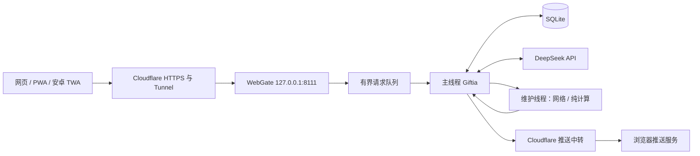

# 项目说明

依据：2026-11-04 源码阅读与[运行基线](records/2026-11-04-baseline.md)。后续事项统一见[路线图](ROADMAP.md)。

## 定位与运行方式

Giftia 将艾拉的寿命、记忆和关系做成持久机制。它面向个人长期文字交流，一个进程只有一个实例和一个搭档；访客与群聊拥有隔离的记忆视角，不是独立角色租户。

Python 3.11+ 标准库提供服务、模型 HTTP 调用、WebSocket 和 Web Push；SQLite 保存状态；网页无需前端构建。安卓 TWA 只是同一网站的入口。生产进程由 `adapters/qq_official.py --web-port 8111 --web-only` 启动，名称保留 QQ，但不连接 QQ。

HTTP 线程负责认证、限流、排队与等待；主线程操作 SQLite 和可变角色状态。维护线程接收纯数据快照，结果由主线程检查来源、实例和版本后提交。主模型生成仍为同步串行，不能把 `Giftia` 当线程安全对象共享。

## 一轮对话

身份与场景 → 记忆视角与称呼 → 到期检查 → 关系/心情 → 近期原话与长期召回 → 人格、状态及来源提示 → 模型与工具 → 消息落库与交付 → 引用强化与维护调度。

默认原话窗口为最近 36 小时，受 40 条、9000 字符限制；每积累 6 条消息触发整理条件。默认启用后台维护与 Conversation 状态。这些是配置与实现能力；生产数据中是否产生预期来源和状态，需要独立核验，不能只靠开关推断。

## 核心机制与契约

| 机制 | 当前行为与边界 |
|---|---|
| 寿命 | 默认 81920 小时，激活时写入数据库；修改默认配置不改变本任寿命。虚拟时钟可用于隔离演示 |
| 长期记忆 | 模型提取摘要和层级；中文单字/二元组 BM25 结合重要性、保留率、层级排序；弱检索可触发查询改写 |
| 分层遗忘 | clear/hazy/blurred/fading/terminal 五阶段收紧召回与模糊；模糊发生在送入模型前，原始正文保留；core 层模糊系数为 0，仍受注入数量与长度预算限制 |
| 召回强化 | `R=exp(-Δt/S)`，`S=720h×(strength+recall_count)`；仅检索到不强化，回复满足字面引用判据才强化；同义转述可能漏判 |
| 置信度 | 注入时区分可确信、需含糊、仅隐约联想；不能借提示补回被模糊的细节 |
| 关系 | 日常互动和记忆奖励有每日上限，升级同时要求亲密度与认识天数；访客不能刷搭档关系 |
| 心情 | 寿命压力、用户语气和按日期确定的漂移共同影响；规则识别有局限，不保证理解所有否定或复杂情绪 |
| 纪念日与关注 | 根据真实日期、关系和记忆中的事件触发；已结束事项应退出活跃关注，具体缺口见路线图 |
| 梦 | 私有记忆模糊后重组；不作为真实经历或可检索事实记忆 |
| 主动联系 | 原因包括终端服务迫近、大日子、回访、心情、纪念日、梦与久未联系；网页仅发给搭档，受额度、间隔和安静时段限制 |
| 回收 | 搭档视角回忆录、运维封存、实例换代；称呼与关系重置。到期检查由下一条搭档消息触发，尚非独立定时回收 |
| 工具 | `remember/search/forget` 服从身份与视角；默认最多 3 轮工具循环、每轮对话最多 2 次主动写入，最后一轮撤去工具以保证回答 |

## 数据视角

| 场景 | 可读取的记忆范围 |
|---|---|
| 搭档私聊 | 搭档私有、其 person 分区及可见群记录 |
| 群聊 | 对应群公开内容，人物印象再按在场范围过滤 |
| 他人私聊 / 网页访客 | 自己的 person 分区；不读取搭档私有内容 |

数据库查询与工具权限承担隔离，提示词只是表达约束。旁听群消息可以落库和随后整理；“不触发时零模型调用”只指当次旁听路径。搭档日记不进入角色提示。全范围封存是运维资产，不能当普通用户可见的回忆录提供。

## 源码地图

| 入口 / 模块 | 职责 |
|---|---|
| [`run.py`](../run.py)、[`cli.py`](../giftia/cli.py) | CLI、管理指令与离线入口 |
| [`qq_official.py`](../adapters/qq_official.py) | 当前网页主循环；保留 QQ 网关、事件、聚批与发送确认 |
| [`brain.py`](../giftia/brain.py) | 角色编排、身份、上下文、提示、工具和维护调度 |
| [`config.py`](../giftia/config.py)、[`config/`](../config/) | 默认值、TOML、个人覆盖、环境变量 |
| [`persona.py`](../giftia/persona.py)、[`llm.py`](../giftia/llm.py) | 系统提示拼接、模型 HTTP、结构化任务、工具协议与 Mock |
| [`store.py`](../giftia/store.py)、[`memory.py`](../giftia/memory.py) | WAL、迁移、事务、消息、检索、整理、模糊与合并 |
| [`conversation.py`](../giftia/conversation.py)、[`maintenance.py`](../giftia/maintenance.py) | 有来源的对话状态；持久维护队列、重试和过期校验 |
| [`lifespan.py`](../giftia/lifespan.py)、[`clock.py`](../giftia/clock.py)、[`recycle.py`](../giftia/recycle.py) | 寿命、虚拟时间、回收与换代 |
| [`bond.py`](../giftia/bond.py)、[`mood.py`](../giftia/mood.py) | 关系与心情 |
| [`occasions.py`](../giftia/occasions.py)、[`dream.py`](../giftia/dream.py)、[`outreach.py`](../giftia/outreach.py) | 日期、梦、主动联系 |
| [`agent_tools.py`](../giftia/agent_tools.py)、[`trigger.py`](../giftia/trigger.py) | 记忆工具权限；QQ 开口与限流决策 |
| [`webgate.py`](../giftia/webgate.py)、[`requests.py`](../giftia/requests.py) | HTTP、请求幂等、身份隔离和恢复账本 |
| [`push.py`](../giftia/push.py)、[`ws.py`](../giftia/ws.py) | Web Push/VAPID、WebSocket 协议 |
| [`web/`](../web/)、[`deploy/`](../deploy/)、[`tools/`](../tools/) | PWA、部署备份与推送 Worker、自测和评测工具 |

## 数据与配置

`data/giftia.db` 保存消息、记忆、关系及实例元数据、梦、日记、来源注解和维护任务。`data/回收日志/`、`data/封存/` 保存历史产物；`backups/` 为数据库热备；`releases/` 为发布快照；推送订阅和最近推送另存 JSON。浏览器显示历史在设备 localStorage，不能靠恢复数据库自动恢复所有设备界面。

`config/persona.toml` 是本地人物默认值，`settings.toml` 是行为参数；同名 `.local.toml` 合并覆盖对应键。`.env` 提供凭据，已存在的环境变量优先。Git 不保存 `data/`、`.env` 或个人覆盖，部署与迁移需另行处理。

当前“角色设定”“本任激活时间”“与当前搭档的共同经历”是不同来源，解释原则见[人物约定](CHARACTER.md)。
